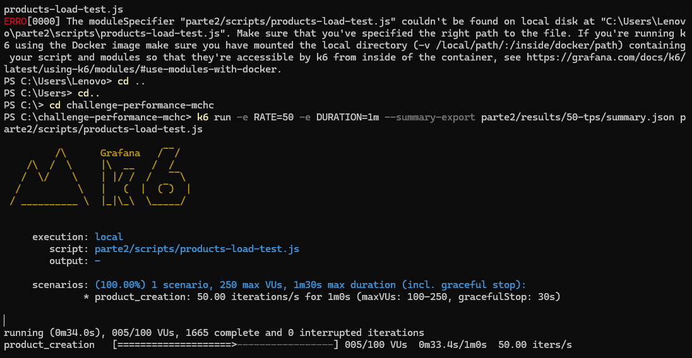
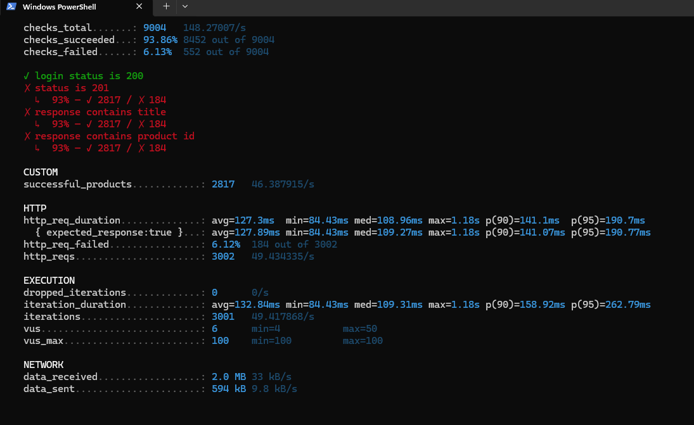

# Estrategia de Pruebas de Performance - E-commerce

## 1. Contexto del negocio

La plataforma de comercio electrónico procesa aproximadamente 1.500 ventas diarias. Durante eventos especiales, como Black Friday y Navidad, el volumen de ventas puede incrementarse hasta cinco veces.

- Ventas normales: 1.500 por día.
- Ventas en fechas especiales: 7.500 por día.
- Incremento de volumen: 400% respecto al volumen habitual.

Este crecimiento puede provocar un incremento en la cantidad de usuarios concurrentes, solicitudes al servidor, consumo de recursos y operaciones sobre la base de datos.

Es importante considerar que el volumen de ventas no equivale directamente a la cantidad de solicitudes por segundo (TPS). Para definir una carga realista se deben analizar los patrones históricos de tráfico, las transacciones por usuario y los horarios de mayor demanda.

## 2. Objetivos de las pruebas

- Validar el comportamiento de la aplicación bajo condiciones normales y de alta demanda.
- Identificar cuellos de botella.
- Medir los tiempos de respuesta.
- Evaluar la estabilidad de la plataforma.
- Determinar la capacidad máxima de procesamiento.
- Verificar el comportamiento ante incrementos repentinos de tráfico.
- Evaluar la recuperación del sistema después de escenarios de alta carga.

## 3. Pruebas de performance propuestas

### 3.1. Prueba de línea base (Baseline Testing)

Establecer el rendimiento inicial del sistema con una carga baja.

**Objetivo:** obtener valores de referencia de tiempos de respuesta, errores y consumo de recursos.

### 3.2. Prueba de carga (Load Testing)

Simular el tráfico esperado en condiciones normales y durante fechas especiales.

**Objetivo:** comprobar que el sistema soporte la demanda prevista sin degradar significativamente la experiencia del usuario.

### 3.3. Prueba de estrés (Stress Testing)

Incrementar progresivamente la carga por encima de los niveles esperados.

**Objetivo:** identificar el límite de capacidad del sistema y el punto en el que comienza a degradarse o fallar.

### 3.4. Prueba de picos (Spike Testing)

Simular incrementos repentinos de tráfico, como los que pueden producirse durante el lanzamiento de una promoción.

**Objetivo:** comprobar que el sistema pueda responder a cambios bruscos de demanda.

### 3.5. Prueba de resistencia (Soak Testing)

Mantener una carga constante durante un período prolongado.

**Objetivo:** identificar problemas como fugas de memoria, degradación progresiva y agotamiento de recursos.

### 3.6. Prueba de recuperación (Recovery Testing)

Evaluar el comportamiento del sistema después de retirar una carga elevada.

**Objetivo:** verificar que la aplicación recupere sus niveles normales de rendimiento y disponibilidad.

## 4. Métricas de rendimiento

Se deberán monitorear las siguientes métricas:

- TPS/RPS: cantidad de transacciones o solicitudes procesadas por segundo.
- Tiempo de respuesta promedio.
- Percentil 95 (p95): tiempo por debajo del cual responde el 95% de las solicitudes.
- Percentil 99 (p99): tiempo por debajo del cual responde el 99% de las solicitudes.
- Tasa de errores HTTP.
- Iteraciones descartadas por el generador de carga.
- Utilización de CPU.
- Consumo de memoria.
- Rendimiento de la base de datos.
- Utilización de red.

## 5. Criterios de aceptación propuestos

Los siguientes valores son objetivos iniciales que deberán validarse con el equipo de negocio y tecnología:

- Tasa de errores inferior al 1%.
- Percentil 95 inferior a 500 ms para las operaciones críticas.
- Sin iteraciones descartadas por el generador de carga.
- Sin interrupciones del servicio.
- Recuperación del sistema después de escenarios de alta demanda.

## 6. Plan de ejecución

1. Identificar los flujos críticos del negocio, como login, búsqueda de productos, etc.
2. Revisar los patrones históricos de tráfico.
3. Definir escenarios y niveles de concurrencia.
4. Preparar el ambiente de pruebas.
5. Ejecutar las pruebas de línea base.
6. Ejecutar las pruebas de carga, estrés, picos y resistencia.
7. Monitorear los indicadores de aplicación e infraestructura.
8. Analizar los resultados y documentar los hallazgos.
9. Repetir las pruebas después de implementar mejoras.

## 7. Recomendaciones

- Utilizar un ambiente representativo de producción.
- Definir objetivos de rendimiento junto con el negocio.
- Monitorear aplicación, infraestructura y base de datos durante las pruebas.
- Ejecutar pruebas periódicamente.
- Analizar tendencias y comparar resultados.
- Identificar y corregir cuellos de botella.
- Evaluar la capacidad de escalamiento horizontal y vertical.

## 8. Conclusión

Se recomienda implementar una estrategia integral de pruebas de performance que incluya pruebas de línea base, carga que es una prueba basica, luego podemos aplicar pruebas estrés, picos, resistencia y recuperación.

Esta estrategia permitirá identificar límites de capacidad, anticipar problemas de rendimiento y reducir el riesgo de indisponibilidad de los servicios durante eventos comerciales de alta demanda.

## 9. Ejecución

Ejecutar el siguiente comando en powershell

Paso1: Ubicarse dentro de la carpeta challenge-performance-mchc

Paso2: Ejecutar el siguiente comando:

k6 run -e RATE=50 -e DURATION=1m --summary-export parte2/results/50-tps/summary.json parte2/scripts/products-load-test.js

Te debe mostrar metricas de la ejecución - Ver imagen referencial

